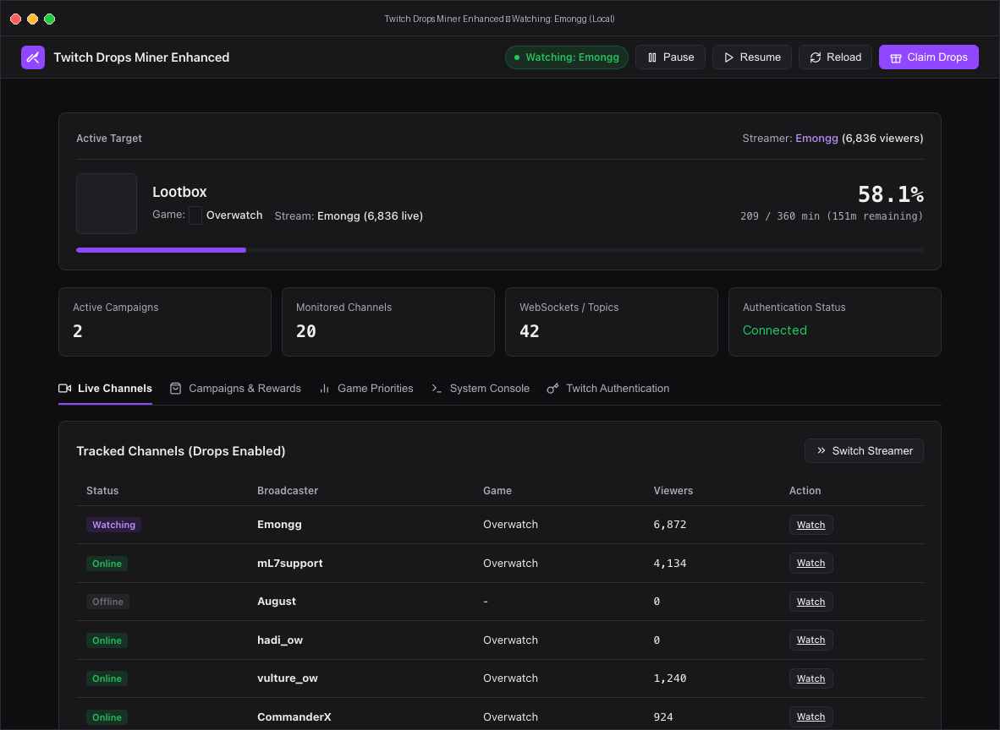
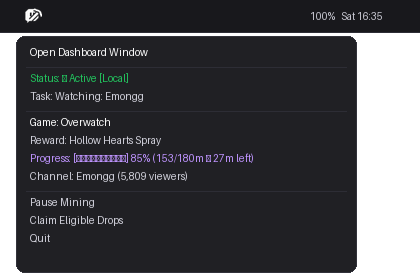

# Twitch Drops Miner Enhanced ⛏️

> **Fork of [DevilXD/TwitchDropsMiner](https://github.com/DevilXD/TwitchDropsMiner)**  
> While we appreciate the core concept of the original project, we needed a modern solution that **actually works reliably**. The original application suffered from severe Tkinter main-thread UI lag on macOS, a dated layout, broken Twitch device authentication (`KeyError: 'device_code'`), and outdated GraphQL query schemas.  
>  
> This project is a ground-up refactor featuring an event-driven headless engine, a native macOS desktop window, a menu bar status extra, a dark-mode stream console, and direct browser cookie login.
>  
> ⚠️ **Platform Availability:**  
> • **macOS**: ✅ **Fully Functional & Optimized** (Native `.app` window, `.dmg` installer, and Menu Bar extra).  
> • **Docker / VPS**: 🟡 **Functional Daemon** (Multi-stage `Dockerfile` and `docker-compose.yml` for 24/7 remote hosting).  
> • **Windows & Linux**: 🚧 **Work in Progress (WIP)** (Headless daemon and web dashboard work; native desktop system tray integration in progress).

---

### 📸 Screenshots

#### Native macOS Application Window


#### macOS Menu Bar Status Extra


---

### ✨ Key Features

- **🍎 Full Native macOS Desktop Window + Menu Bar Status Extra**:
  - **Desktop Window (`WKWebView`)**: Responsive dark-mode console displaying your live campaign progress, game box art covers, item reward icons, and 20 monitored streams.
  - **Channel Selection**: **Watch** in the tracked-channel list switches the miner to that eligible live channel; it does not open Twitch in a browser. Offline channels are disabled, and unavailable or ineligible channels report an error.
  - **Active Target**: Shows the campaign name as well as the reward. Inventory refresh rebinds the target to fresh campaign data and clears it when the current channel can no longer earn a reward.
  - **Menu Bar Extra (`NSStatusItem`)**: Custom Twitch + pickaxe template icon in your macOS menu bar displaying real-time progress (`[████████░░] 85%`), active streamer, viewer counts, and quick actions upon clicking.
  - **Close to Menu Bar**: Hides the window and removes the Dock icon while mining and menu bar status remain active. Use **Open Dashboard Window** in the status menu to restore the window and Dock icon.
  - **Window Close Preference**: **Keep running in the menu bar when closing the window** is enabled by default, available in **Settings → Application** and both native menus, and saved across restarts. It applies to the red close button and `Cmd+W`; disable it to quit when closing the window. **Quit** (`Cmd+Q`) always exits the app.
  - **Settings**: One tab for the Twitch account, auto-claim preference, game-priority editor, and native application preferences, shown below the dashboard overview. Open the **Settings** tab or press `Cmd+,` on macOS. **Application** controls include the close preference, menu bar display style, and miner connection (local or remote Docker server); they appear only in the native app.
- **⚡ Zero-Lag Decoupled Architecture**:
  - Replaced the blocking 50–100Hz Tkinter polling loop with an async, event-driven `StateHub` that consumes 0.0% idle CPU.
- **🔐 Modern Authentication & Captcha-Free Login**:
  - **Fixed `KeyError: 'device_code'`**: Switched to Twitch's active `SMARTBOX` client for OAuth device-code activation.
  - **Quick Copy**: Click-to-copy button for the activation code in the app banner and menu bar.
  - **Direct `auth-token` Cookie Login**: Paste your browser's Twitch `auth-token` cookie under **Settings → Twitch account → Advanced**. The password field clears after saving, and credentials are never returned in status/settings responses.
  - **Disconnect & Reconnect**: While an account is connected, **Settings → Twitch account** shows only **Disconnect**. Confirm it to stop mining and remove this app's saved token, cookies, and account-specific data. The app stays disconnected across restarts, even with `TWITCH_AUTH_TOKEN` configured, until you explicitly connect again. Preferences remain saved. Once disconnected, **Connect with Twitch** starts device activation, and saving a browser token under **Advanced** also reconnects. This is local to the miner—it does not sign out your browser or revoke Twitch authorization. On a remote connection, it disconnects the account on that miner server.
- **🎮 Visual Game Priorities Manager**:
  - Interactive game selection dropdown combining active campaign games on your account and popular Twitch drop titles.
  - Quick-add chips with active campaign counters (e.g. `+ Overwatch (2)`).
  - Visual ranked priority cards with rank badges, Move Up (`▲`), Move Down (`▼`), and Delete (`✕`) controls.
  - One-click `+ Prioritize` button directly on every campaign card.
- **Campaign schedule and reward claiming**:
  - Each campaign shows its start and end dates in your local timezone, plus time remaining.
  - Fully claimed campaigns are hidden. Ended campaigns remain visible only while this account has an eligible, unclaimed reward within Twitch's claim window; only those claimable rewards are listed for ended campaigns.
  - Campaign totals and game-picker counts use the same filtered inventory and update after claims.
  - Toggle **Automatically claim ready drops** in **Settings → Rewards**, or use the synchronized **Auto-claim drops** shortcut in **Campaigns & Rewards**. Enabled by default to preserve existing behavior; saved across backend restarts.
  - When disabled, rewards remain available for manual claiming using **Claim**. Dependent rewards may require the previous reward to be claimed before progressing.
- **🐳 Docker & Remote VPS Support**:
  - Headless daemon container ready for deployment on any VPS (via Docker Compose or Dokploy).
  - **Client-Server Switcher**: In **Settings → Application → Miner connection**, choose **Local (this Mac)** (`http://127.0.0.1:23432`) or **Remote server (Docker)** with its URL and optional API key, then **Save & reconnect**. The API key stays in the macOS app and is never shown in the page. If the miner can't be reached, use **Connection Settings…** on the offline screen or in the native menus.
  - Optional `API_KEY` Bearer authentication for secure public hosting.

---

### 🚀 Installation (macOS Apple Silicon)

1. **Download the latest release:**
   - **`TwitchDropsMinerEnhanced-vX.Y.Z-macOS-arm64.dmg`**: Drag-and-drop installer disk image (for example `TwitchDropsMinerEnhanced-v1.4.1-macOS-arm64.dmg`).
   - **`TwitchDropsMinerEnhanced-vX.Y.Z-macOS-arm64.zip`**: Portable application archive.
2. **Install:**
   - Double-click the `.dmg` and drag **Twitch Drops Miner Enhanced** into your **Applications** folder.
3. **Launch:**
   - Open **Twitch Drops Miner Enhanced** from Applications or Spotlight.
   - The app window and menu bar icon will appear.
   - Authenticate via the Twitch device-code prompt, or open **Settings → Twitch account** to connect or paste a browser `auth-token` under **Advanced**.

---

### 🐳 Remote VPS Deployment (Docker / Dokploy)

You can run the mining engine 24/7 on your VPS inside Docker and connect to it from the macOS desktop app:

1. **Deploy with Docker Compose:**
   ```bash
   docker compose up -d
   ```
   *(Or deploy the repository in **Dokploy** as a Compose stack).*

2. **Environment Variables:**
   ```env
   PORT=23432                           # Web Dashboard & API Port
   DATA_DIR=/app/data                   # Persistent volume for cookies and settings
   API_KEY=your_secure_api_key_here     # Optional: Bearer authentication for public access
   TWITCH_AUTH_TOKEN=your_token_here    # Optional: Pre-configured Twitch auth-token
   ```

3. **Connect from macOS App:**
   - Open `TwitchDropsMinerEnhanced.app` on your Mac.
   - Open **Settings → Application → Miner connection** (or **Connection Settings...** in the menus).
   - Select **Remote server (Docker)** &rarr; enter your VPS address (e.g. `https://miner.yourdomain.com` or `http://vps-ip:23432`) and API key, then **Save & reconnect**.
   - The macOS app immediately syncs with your remote miner.

---

### 🛠️ Building from Source (macOS)

```bash
git clone https://github.com/renan-brasilio/TwitchDropsMinerEnhanced.git
cd TwitchDropsMinerEnhanced

# Set up virtual environment
python3 -m venv venv
./venv/bin/pip install -r requirements.txt truststore

# Build the native macOS application, DMG installer, and ZIP archive
./build_mac.sh

# Launch
open TwitchDropsMinerEnhanced.app
```

---

### Running the Regression Suite

```bash
./venv/bin/pip install -r requirements-dev.txt
./venv/bin/python -m playwright install chromium

# Unit, API contract, PubSub, settings, release-metadata and dashboard E2E tests, with branch coverage
REQUIRE_E2E=1 ./venv/bin/coverage run -m unittest discover -s tests -v
./venv/bin/coverage report
```

- Tests never contact Twitch. Twitch is replaced by local fake servers at the network boundary, and the miner's own API, account lifecycle, and settings persistence run for real against temporary data directories.
- The dashboard E2E tests (`tests/e2e/`) use Playwright with Chromium. Without Playwright installed they are skipped; `REQUIRE_E2E=1` turns that into a failure, as in CI.
- `coverage report` fails below the floor in `.coveragerc`. Raise that floor when coverage improves; never lower it.
- The native app's logic (connection rules, URLs, settings bridge, status parsing, menu bar text) has Swift tests: `swift test --package-path mac`.
- A native UI smoke test drives a separate test copy of the app (its own bundle id and settings) against a fake miner: `RUN_NATIVE_UI=1 ./venv/bin/python -m unittest tests.native.test_native_app -v`. It needs Accessibility permission for your terminal and runs only on demand, never in CI.
- The **Tests** workflow runs the Python suite on Python 3.10 and 3.12, and the Swift tests on macOS, for every push and pull request. Release tags run both again before packaging.
- Risk areas, priorities, and test conventions are recorded in `.agents/qa-project-context.md`.

---

### ⚙️ How It Works Under the Hood

Every several seconds, the application simulates watching an authorized stream by fetching stream metadata and playlist chunk headers. This advances Twitch drop progress without downloading video or audio data, saving bandwidth and system resources.

To maintain channel state (Online / Offline / Viewers), an asynchronous sharded WebSocket pool connects to Twitch PubSub Edge (`wss://pubsub-edge.twitch.tv/v1`), receiving real-time events for stream status changes, viewer counts, and drop progress completions. When a reward becomes claimable, the miner claims it if **Auto-claim drops** is enabled; otherwise it waits for manual claiming.
